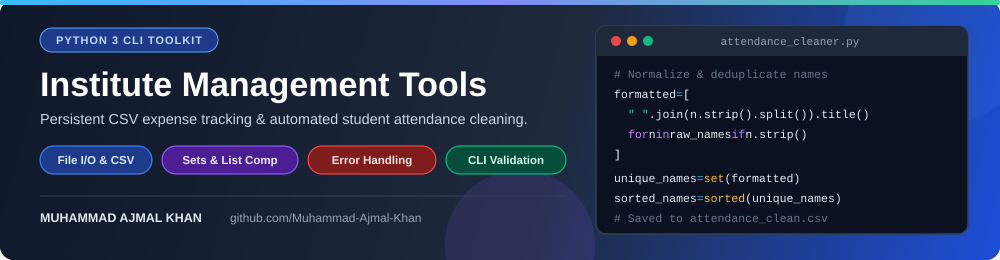
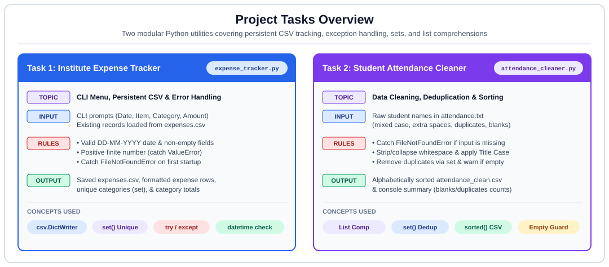
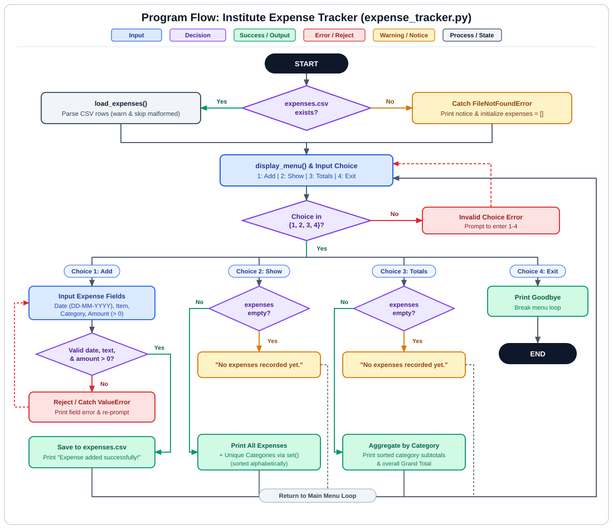
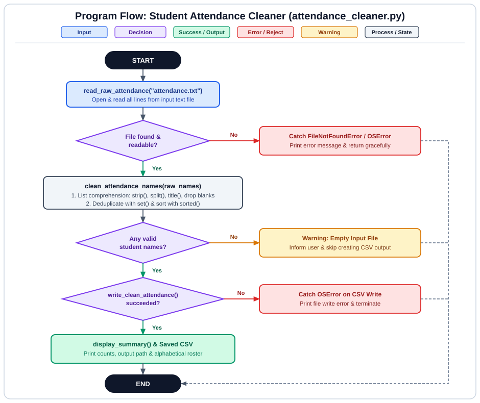
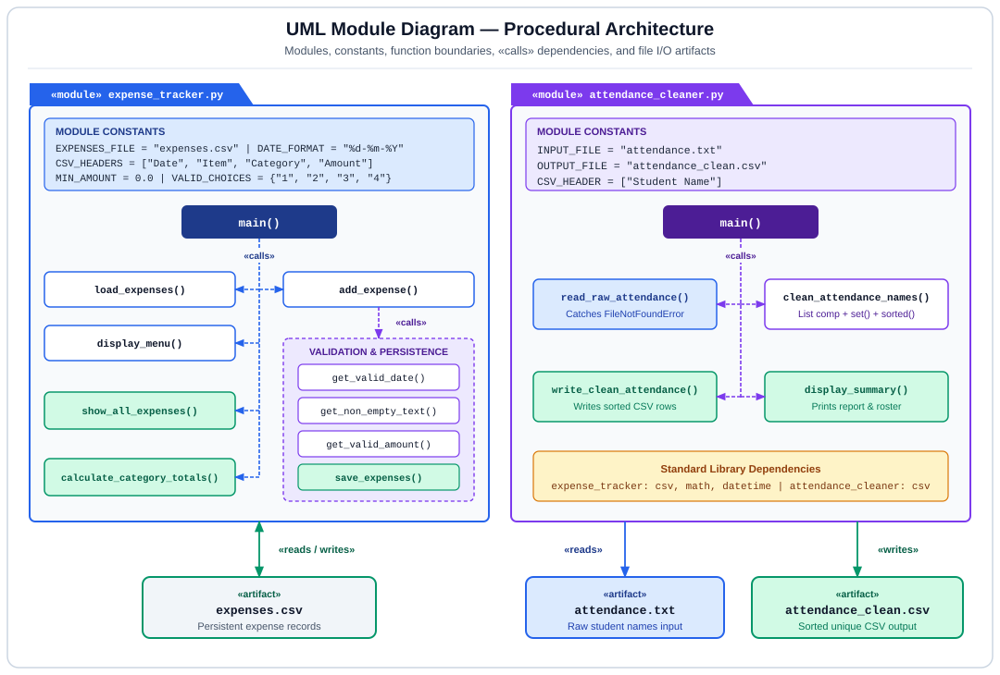

<p align="center"></p>

## 1. Project Overview

This repository provides two modular Python 3 command-line management utilities built for a training institute: persistent daily expense tracking and automated student attendance cleaning.

| Task | Tool Name | File | Core Topics |
| --- | --- | --- | --- |
| Task 1 | Institute Expense Tracker | `expense_tracker.py` | CLI menu loop, CSV persistence (`expenses.csv`), `set()` unique categories, `FileNotFoundError` & `ValueError` handling |
| Task 2 | Student Attendance Cleaner | `attendance_cleaner.py` | Text/CSV File I/O, list comprehensions, `set()` deduplication, alphabetical sorting, `FileNotFoundError` handling |

<p align="center"></p>

---

## 2. Folder Structure

```text
institute-management-tools/
├── assets/
│   ├── attendance_cleaner_flow.svg
│   ├── banner.svg
│   ├── expense_tracker_flow.svg
│   ├── overview.svg
│   └── uml_diagram.svg
├── attendance.txt
├── attendance_cleaner.py
├── expense_tracker.py
└── README.md
```

> **Runtime files:** `expenses.csv` is created automatically by `expense_tracker.py` when the first expense is added, and `attendance_clean.csv` is generated by `attendance_cleaner.py` from `attendance.txt`.

---

## 3. Task 1: Institute Expense Tracker (`expense_tracker.py`)

### Summary
`expense_tracker.py` is an interactive menu-driven CLI application for recording, inspecting, and summarizing operational expenses (such as Stationery, Internet, and Transport). All entries persist across sessions in `expenses.csv`. On startup, `load_expenses()` catches `FileNotFoundError` so first-time runs begin cleanly with an empty list instead of crashing. When displaying all expenses, a Python `set()` extracts only unique categories, while category subtotals and a grand total can be calculated on demand.

### Rules & Requirements
- Load existing records from `expenses.csv` on startup; catch `FileNotFoundError` gracefully if the file does not exist yet.
- Provide a 4-option menu loop: **Add New Expense**, **Show All Expenses**, **Calculate Total Expenses by Category**, and **Exit**.
- Validate date format (`DD-MM-YYYY`), non-empty item and category text, and positive finite numeric amounts (catching `ValueError` and re-prompting without stopping execution).
- Extract and display unique expense categories using a `set()`.
- Persist updated expense records to `expenses.csv` immediately after adding a valid entry.

### Program Flow
<p align="center"></p>

### Code Methods Description

| Function / Section | Purpose |
| --- | --- |
| Constants (`EXPENSES_FILE`, `CSV_HEADERS`, `DATE_FORMAT`, `MIN_AMOUNT`, `VALID_CHOICES`) | Centralizes file names, CSV columns, date formatting, amount floor, and menu options to avoid magic numbers. |
| `load_expenses(filepath)` | Reads saved records from `expenses.csv`, catches `FileNotFoundError`/`OSError`, and skips malformed rows with a warning. |
| `save_expenses(expenses, filepath)` | Writes all expense dictionaries to `expenses.csv` using `csv.DictWriter`. |
| `get_valid_date()` | Re-prompts until the user supplies a real calendar date matching `DD-MM-YYYY`. |
| `get_non_empty_text(prompt, field_name)` | Strips extra whitespace and re-prompts until non-empty text is entered. |
| `get_valid_amount()` | Converts input to `float`, catches `ValueError` for non-numeric strings, and rejects values `<= 0` or non-finite (`NaN`/`inf`). |
| `add_expense(expenses, filepath)` | Collects validated fields, normalizes category casing with `.title()`, appends the record, and saves to CSV. |
| `show_all_expenses(expenses)` | Lists every expense and uses `set()` to print sorted unique categories once each. |
| `calculate_category_totals(expenses)` | Aggregates spending per category in alphabetical order and prints the overall grand total. |
| `display_menu()` | Prints the 4-option interactive CLI menu. |
| `main()` | Loads existing data and manages the menu dispatch loop with graceful exit on choice `4` or `EOFError`/`KeyboardInterrupt`. |

### Input Validation
- **Menu Choice:** Rejects anything outside `{"1", "2", "3", "4"}` and re-displays the menu.
- **Date (`DD-MM-YYYY`):** Rejects blank strings, wrong formats (e.g., `2023-11-18`), and impossible calendar dates (e.g., `31-02-2023`).
- **Item Name & Category:** Rejects empty or whitespace-only entries and collapses repeated internal spaces; categories are normalized to Title Case so `stationery` and `Stationery` group together.
- **Amount:** Catches `ValueError` for text inputs (e.g., `"hundred"`, `"fifty"`) and rejects `0`, negative numbers, `nan`, or `inf`.
- **CSV Recovery:** Skips corrupted rows in `expenses.csv` with a row-numbered warning rather than crashing.

### Expected Results
- First launch without `expenses.csv` prints a startup notice and initializes an empty list.
- Valid expenses save immediately to `expenses.csv` and reload automatically on subsequent runs.
- Viewing expenses displays each record with two-decimal amounts followed by a deduplicated `Unique Expense Categories` line.
- Category totals display sorted per-category subtotals and an accurate `Grand Total`.

---

## 4. Task 2: Student Attendance Cleaner (`attendance_cleaner.py`)

### Summary
`attendance_cleaner.py` automates cleaning raw student attendance rosters stored in `attendance.txt`. It uses a single **list comprehension** (`[" ".join(name.strip().split()).title() for name in raw_names if name.strip()]`) to remove blank lines, collapse stray spaces, and normalize capitalization to Title Case. Converting the cleaned list into a **`set()`** removes duplicate entries automatically before sorting alphabetically and exporting the clean roster to `attendance_clean.csv`.

### Rules & Requirements
- Read raw lines from `attendance.txt` and catch `FileNotFoundError` with an informative message if the file is missing.
- Use a list comprehension to strip/normalize whitespace, skip blank lines, and format names in Title Case.
- Use a `set()` to eliminate duplicate student names regardless of original spacing or casing.
- Sort the unique names alphabetically and save them under the `Student Name` header in `attendance_clean.csv`.
- Warn the user and skip creating an output CSV if `attendance.txt` contains no valid names.

### Program Flow
<p align="center"></p>

### Code Methods Description

| Function / Section | Purpose |
| --- | --- |
| Constants (`INPUT_FILE`, `OUTPUT_FILE`, `CSV_HEADER`) | Defines input/output file paths (`attendance.txt`, `attendance_clean.csv`) and the CSV header row. |
| `read_raw_attendance(filepath)` | Reads all raw lines from `attendance.txt`, catching `FileNotFoundError` and `OSError` safely. |
| `clean_attendance_names(raw_names)` | Uses a list comprehension for whitespace/casing cleanup, a `set()` for deduplication, and `sorted()` for alphabetical ordering; returns cleaned names plus skipped/duplicate counts. |
| `write_clean_attendance(clean_names, filepath)` | Exports the cleaned roster to `attendance_clean.csv` using `csv.writer` and catches `OSError`. |
| `display_summary(...)` | Prints statistics (raw lines, blanks skipped, duplicates removed, unique students saved) and the numbered alphabetical roster. |
| `main()` | Orchestrates the read → clean → empty check → write → summary pipeline. |

### Input Validation
- **Missing Input File:** Catches `FileNotFoundError` when `attendance.txt` is absent and prints a clear error message.
- **Empty / Whitespace-Only File:** Detects when zero valid names remain after filtering blanks, prints a warning, and avoids writing an empty CSV.
- **Messy Whitespace & Casing:** Collapses leading, trailing, and multi-space gaps (`"  ali   khan"` and `"ALI KHAN"` both normalize to `"Ali Khan"`).
- **File I/O Errors:** Handles `OSError` on both file read and CSV write operations.

### Expected Results
- Produces `attendance_clean.csv` with a `Student Name` header followed by unique, Title-Cased student names in alphabetical order.
- Prints a terminal summary showing exact counts for raw lines read, blank lines skipped, duplicates removed, and unique students saved.

---

## 5. UML Diagram

A **UML Module Diagram** was chosen because both utilities follow a clean procedural architecture built around module-level constants, small single-purpose functions, `«calls»` relationships, and external file I/O artifacts rather than OOP classes.

<p align="center"></p>

---

## 6. Concepts and Techniques Used

- **Exception Handling (`try` / `except`):**
  - `FileNotFoundError` handled gracefully in both `expense_tracker.py` (starts with an empty list) and `attendance_cleaner.py` (informs user without traceback).
  - `ValueError` caught during amount conversion and date parsing in `expense_tracker.py`, re-prompting without interrupting the session.
  - `OSError`, `EOFError`, and `KeyboardInterrupt` handled cleanly for resilient CLI operation.
- **List Comprehensions:** Single-pass filtering and normalization in `attendance_cleaner.py` using `[" ".join(name.strip().split()).title() for name in raw_names if name.strip()]`.
- **Sets (`set()`):** Automatic deduplication of student names in `attendance_cleaner.py` and extraction of unique expense categories in `expense_tracker.py`.
- **CSV Persistence (`csv` module):** Structured reading/writing via `csv.DictReader`, `csv.DictWriter`, and `csv.writer`.
- **Date & Numeric Validation:** Strict calendar checks with `datetime.strptime()` and finite positive checks with `math.isfinite()`.
- **Modular Procedural Design:** Named constants instead of magic values and focused, testable helper functions.

---

## 7. How to Run

### Requirements
- Python 3.8 or higher (standard library only — no third-party packages required).

### Clone the Repository
```bash
git clone https://github.com/Muhammad-Ajmal-Khan/institute-management-tools.git
cd institute-management-tools
```

### Run Task 1: Institute Expense Tracker
```bash
python expense_tracker.py
```
Alternative commands (depending on OS/environment):
```bash
python3 expense_tracker.py   # macOS / Linux
py expense_tracker.py        # Windows Python Launcher
```

### Run Task 2: Student Attendance Cleaner
Ensure `attendance.txt` is present in the same directory (a sample file is included), then run:
```bash
python attendance_cleaner.py
```
Alternative commands:
```bash
python3 attendance_cleaner.py   # macOS / Linux
py attendance_cleaner.py        # Windows Python Launcher
```

---

## 8. Sample Execution

All outputs below were captured directly from running the scripts in Python 3.

### Task 1: Institute Expense Tracker

**Run 1 — Missing `expenses.csv` Startup, `ValueError` Recovery & Saving:**
```text
Notice: 'expenses.csv' not found. Starting with an empty expense list.

--- Institute Expense Tracker ---
1. Add New Expense
2. Show All Expenses
3. Calculate Total Expenses by Category
4. Exit
Enter your choice (1-4): 1
Enter date (DD-MM-YYYY): 14-11-2023
Enter item name: Whiteboard Markers
Enter category (e.g., Stationery, Transport): Stationery
Enter amount: hundred
Invalid input! Please enter a valid number for the amount.
Enter amount: 100
Expense added successfully!

--- Institute Expense Tracker ---
1. Add New Expense
2. Show All Expenses
3. Calculate Total Expenses by Category
4. Exit
Enter your choice (1-4): 4
Exiting Institute Expense Tracker. Goodbye!
```

**Run 2 — Reloading Persisted CSV, Adding More Items, Unique Categories & Category Totals:**
```text
--- Institute Expense Tracker ---
1. Add New Expense
2. Show All Expenses
3. Calculate Total Expenses by Category
4. Exit
Enter your choice (1-4): 1
Enter date (DD-MM-YYYY): 15-11-2023
Enter item name: A4 Printing Paper
Enter category (e.g., Stationery, Transport): stationery
Enter amount: 450.50
Expense added successfully!

--- Institute Expense Tracker ---
1. Add New Expense
2. Show All Expenses
3. Calculate Total Expenses by Category
4. Exit
Enter your choice (1-4): 1
Enter date (DD-MM-YYYY): 16-11-2023
Enter item name: Fiber Internet Bill
Enter category (e.g., Stationery, Transport): Internet
Enter amount: 3500
Expense added successfully!

--- Institute Expense Tracker ---
1. Add New Expense
2. Show All Expenses
3. Calculate Total Expenses by Category
4. Exit
Enter your choice (1-4): 2

--- All Expenses ---
Date: 14-11-2023, Item: Whiteboard Markers, Category: Stationery, Amount: 100.00
Date: 15-11-2023, Item: A4 Printing Paper, Category: Stationery, Amount: 450.50
Date: 16-11-2023, Item: Fiber Internet Bill, Category: Internet, Amount: 3500.00

Unique Expense Categories: Internet, Stationery

--- Institute Expense Tracker ---
1. Add New Expense
2. Show All Expenses
3. Calculate Total Expenses by Category
4. Exit
Enter your choice (1-4): 3

--- Total Expenses by Category ---
Internet: 3500.00
Stationery: 550.50
Grand Total: 4050.50

--- Institute Expense Tracker ---
1. Add New Expense
2. Show All Expenses
3. Calculate Total Expenses by Category
4. Exit
Enter your choice (1-4): 4
Exiting Institute Expense Tracker. Goodbye!
```

**Run 3 — Invalid Menu Choice, Invalid Date, Empty Item & Negative Amount Rejection:**
```text
--- Institute Expense Tracker ---
1. Add New Expense
2. Show All Expenses
3. Calculate Total Expenses by Category
4. Exit
Enter your choice (1-4): 9
Invalid choice! Please enter a number between 1 and 4.

--- Institute Expense Tracker ---
1. Add New Expense
2. Show All Expenses
3. Calculate Total Expenses by Category
4. Exit
Enter your choice (1-4): 1
Enter date (DD-MM-YYYY): 31-02-2023
Invalid input! Please enter a valid date in DD-MM-YYYY format (e.g., 14-11-2023).
Enter date (DD-MM-YYYY): 18-11-2023
Enter item name: 
Invalid input! Item name cannot be empty.
Enter item name: Ink Refill
Enter category (e.g., Stationery, Transport): Stationery
Enter amount: -50
Invalid input! Amount must be a number greater than 0.
Enter amount: 250
Expense added successfully!

--- Institute Expense Tracker ---
1. Add New Expense
2. Show All Expenses
3. Calculate Total Expenses by Category
4. Exit
Enter your choice (1-4): 4
Exiting Institute Expense Tracker. Goodbye!
```

### Task 2: Student Attendance Cleaner

**Run 1 — Normal Messy Roster (`attendance.txt` with duplicates, blank lines, extra spaces & mixed case):**
```text
--- Student Attendance Cleaning Summary ---
Raw lines read        : 13
Blank lines skipped   : 2
Duplicates removed    : 4
Unique students saved : 7
Output saved to       : attendance_clean.csv

Cleaned Attendance List (Alphabetical):
1. Ali Khan
2. Ayesha Malik
3. Bilal Raza
4. Hamza Siddiqui
5. Sara Ahmed
6. Usman Tariq
7. Zainab Fatima
```

**Run 2 — Missing Input File (`FileNotFoundError`):**
```text
Error: Input file 'attendance.txt' was not found. Please ensure it exists in the current directory.
```

**Run 3 — Empty / Whitespace-Only `attendance.txt` Edge Case:**
```text
Warning: 'attendance.txt' contains no valid student names. No output file was created.
```

---

## 9. Test Cases

### Task 1: `expense_tracker.py`

| # | Scenario | Inputs | Expected Result |
| --- | --- | --- | --- |
| 1 | First run with missing `expenses.csv` | Launch script without CSV; select `2`, `3`, `4` | Catches `FileNotFoundError`, prints startup notice, shows `"No expenses recorded yet."` for options `2` and `3`, exits cleanly |
| 2 | Valid add with `ValueError` recovery | `1` → `14-11-2023`, `Whiteboard Markers`, `Stationery`, `hundred` → `100` | Rejects `"hundred"` with number error, accepts `100`, saves `expenses.csv`, prints `"Expense added successfully!"` |
| 3 | Reload persistence & case-normalized grouping | Restart; add `stationery` (`450.50`) and `Internet` (`3500`); select `2` and `3` | Reloads prior row, merges `stationery` with `Stationery`, prints unique categories `Internet, Stationery`, totals `Internet: 3500.00`, `Stationery: 550.50`, `Grand Total: 4050.50` |
| 4 | Boundary smallest positive amount | Add `17-11-2023`, `Bus Fare`, `Transport`, `0.01` | Accepted and formatted as `0.01` |
| 5 | Invalid menu selections | `9`, `abc` | Prints `"Invalid choice! Please enter a number between 1 and 4."` and loops |
| 6 | Multiple field validation failures in sequence | Date: `""`, `2023-11-18`, `31-02-2023` → `18-11-2023`; Item: `"   "` → `Ink Refill`; Category: `"   "` → `Stationery`; Amount: `fifty`, `0`, `-25`, `nan` → `250` | Rejects each invalid entry with a specific message and saves once all valid fields are entered |
| 7 | Corrupted CSV rows on load | Append non-numeric and negative rows to `expenses.csv`; restart | Prints row-numbered warnings for malformed rows and loads remaining valid records |

### Task 2: `attendance_cleaner.py`

| # | Scenario | Inputs | Expected Result |
| --- | --- | --- | --- |
| 1 | Missing `attendance.txt` | Run script with no input file | Catches `FileNotFoundError` and prints clear missing-file error |
| 2 | Messy roster with blanks, extra spaces, mixed case & duplicates | Sample `attendance.txt` (13 lines: 2 blanks, 4 duplicates, 7 unique names) | Skips 2 blanks, removes 4 duplicates, writes 7 Title-Cased sorted names to `attendance_clean.csv` |
| 3 | Whitespace-only input file | `attendance.txt` containing only spaces, tabs, and newlines | Prints empty-file warning and does not create `attendance_clean.csv` |
| 4 | Single student repeated in varied formats | `ali khan`, `  ALI   KHAN `, `Ali Khan` | Deduplicates to 1 entry (`Ali Khan`) with `Duplicates removed : 2` |
| 5 | Already clean, unique, sorted input | `Ayesha Malik`, `Bilal Raza`, `Sara Ahmed` | Saves all 3 names unchanged with `Blank lines skipped : 0` and `Duplicates removed : 0` |

---

**Author:** MUHAMMAD AJMAL KHAN — [GitHub Profile](https://github.com/Muhammad-Ajmal-Khan)
